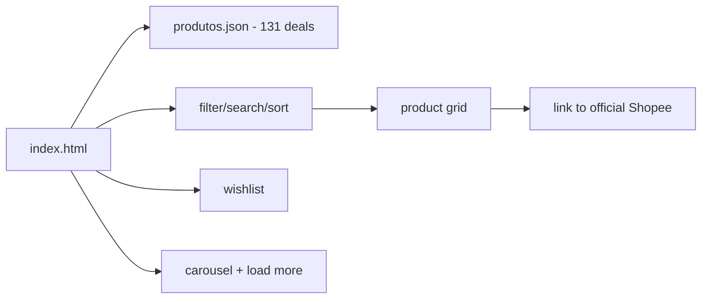

# garimpo

**English** · [Português (Brasil)](README.md)

[](#) [](#) [](#) [](#) [](LICENSE)

## What it is

**Garimpo** is a **100% client-side** curation of **131 Shopee deals** across 8 categories. The user filters, searches, sorts and saves favorites (wishlist) without leaving the page; each product links directly to the official Shopee store, which handles payment and delivery. There is no sign-up, account or tracking.

## Status

In production. Published at <https://kelvinoliveiracode.github.io/garimpo/> (HTTP 200 verified).

## Features

- **Catalog of 131 products** in 8 categories (data in `produtos.json`: id, category, title, price, store, badge, rating, img, link).
- **Category filter**, **search** and **sorting** in real time, with a result counter.
- **Wishlist** (favorites) with a counter and a dedicated button.
- **Featured carousel** with a countdown, and a "load more" button.
- **SEO**: sitemap, robots, Open Graph/Twitter and structured JSON-LD data (`ItemList`, `Organization`, `WebSite`).
- **Zero build, zero dependency**: one `index.html` + `produtos.json`; each product links to the official Shopee store.

> Note: the previous README described a **cloud-services catalog** (124 AWS/GCP providers) — it does not exist in this repository. Corrected.

## Architecture

A single-page static site: `index.html` (841 lines) loads `produtos.json` and renders the grid with vanilla JavaScript. No framework, no build and no backend — clicks go to Shopee.



## Stack

- HTML5, CSS3 and vanilla ES6+ JavaScript
- JSON (product data)
- Hosting: GitHub Pages

## Repository layout

```
garimpo/
├── index.html       # the whole page (841 lines)
├── produtos.json    # 131 deals in 8 categories
├── robots.txt · sitemap.xml
├── img/             # product images
└── LICENSE          # MIT
```

## Prerequisites and installation

None. Just serve the folder statically (content is assembled via `fetch` from `produtos.json`, so it does not open as `file://`).

## How to run

```bash
python -m http.server 8080
# then visit http://localhost:8080
```

## Tests and quality

There are no automated tests, no `package.json` and no CI in this repository (confirmed). Behavior is validated manually in the browser.

## Technical decisions and trade-offs

- **100% client-side, no backend**: no sign-up or tracking; the purchase happens on Shopee.
- **Data in a separate JSON**: adding/editing a deal does not require touching the HTML.
- **Rendered with vanilla JavaScript**: no framework, lightweight load.
- **SEO with structured data** and a sitemap to index the curation.

## Known limitations and roadmap

- Price/badge come from a snapshot in `produtos.json`; there is no automatic sync with Shopee.
- The wishlist persists in the browser (localStorage, key `garimpo_wishlist`); filters/search are not saved.
- No real pagination — "load more" shows more items from the same catalog.

## Development process

An individual project by Kelvin Oliveira, built with orchestrated AI agents and reviewed by the author. The deal curation, the client-side architecture and the review are the author's.

## License and author

MIT — Copyright (c) 2026 Kelvin Rebelo de Oliveira.

**Author**: [Kelvin Oliveira](https://github.com/KelvinOliveiraCode) · [Portfolio](https://kelvinoliveiracode.github.io/portfolio/)
