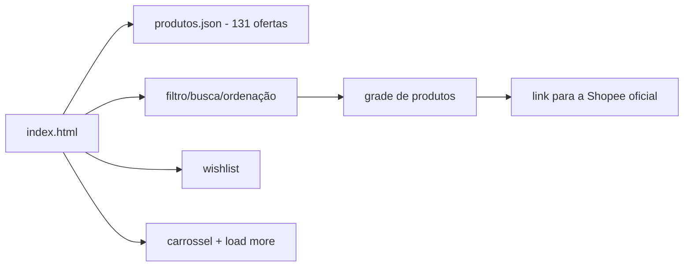

# garimpo

[English](README.en.md) · **Português (Brasil)**

[](#) [](#) [](#) [](#) [](LICENSE)

## O que é

**Garimpo** é uma curadoria **100% client-side** de **131 ofertas da Shopee** em 8 categorias. O usuário filtra, busca, ordena e salva favoritos (wishlist) sem sair da página; cada produto tem link direto para a loja oficial da Shopee, que cobra e entrega. Não há cadastro, conta nem tracking.

## Status

Em produção. Publicado em <https://kelvinoliveiracode.github.io/garimpo/> (HTTP 200 verificado).

## Funcionalidades

- **Catálogo de 131 produtos** em 8 categorias (dados em `produtos.json`: id, categoria, título, preço, loja, selo, rating, img, link).
- **Filtro por categoria**, **busca** e **ordenação** (sort) em tempo real, com contador de resultados.
- **Wishlist** (favoritos) com contador e botão dedicado.
- **Carrossel de destaques** com countdown, e botão "carregar mais" (load more).
- **SEO**: sitemap, robots, Open Graph/Twitter e dados estruturados JSON-LD (`ItemList`, `Organization`, `WebSite`).
- **Zero build, zero dependência**: um `index.html` + `produtos.json`; o produto é linkado à Shopee oficial.

> Nota: o README anterior descrevia um **catálogo de serviços de nuvem** (124 provedores da AWS/GCP) — não existe neste repositório. Corrigido.

## Arquitetura

Site estático de página única: `index.html` (841 linhas) carrega `produtos.json` e monta a grade com JavaScript vanilla. Sem framework, sem build e sem backend — os cliques vão para a Shopee.



## Stack

- HTML5, CSS3 e JavaScript ES6+ vanilla
- JSON (dados de produtos)
- Hospedagem: GitHub Pages

## Estrutura do repositório

```
garimpo/
├── index.html       # a página inteira (841 linhas)
├── produtos.json    # 131 ofertas em 8 categorias
├── robots.txt · sitemap.xml
├── img/             # imagens dos produtos
└── LICENSE          # MIT
```

## Pré-requisitos e instalação

Nenhum. Basta servir a pasta estaticamente (o conteúdo é montado via `fetch` de `produtos.json`, então não abre como `file://`).

## Como executar

```bash
python -m http.server 8080
# acesse http://localhost:8080
```

## Testes e qualidade

Não há testes automatizados nem deploy de CI neste repositório (ausência de pasta de testes, de `package.json` e de workflow confirmada). O comportamento é validado manualmente no navegador.

## Decisões técnicas e trade-offs

- **100% client-side, sem backend**: sem cadastro nem tracking; a conversão (compra) acontece na Shopee.
- **Dados em JSON separado**: adicionar/editar uma oferta não exige mexer no HTML.
- **Renderização com JavaScript vanilla**: sem framework, carregamento leve.
- **SEO com dados estruturados** e sitemap para indexação da curadoria.

## Limitações conhecidas e roadmap

- O preço/selo vêm de um snapshot em `produtos.json`; não há sincronização automática com a Shopee.
- A wishlist persiste no navegador (localStorage, chave `garimpo_wishlist`); filtros/busca não são salvos.
- Sem paginação real — o "carregar mais" exibe mais itens do mesmo catálogo.

## Processo de desenvolvimento

Projeto individual de Kelvin Oliveira, construído com agentes de IA orquestrados e revisado pelo autor. A curadoria das ofertas, a arquitetura client-side e a revisão são do autor.

## Licença e autor

MIT — Copyright (c) 2026 Kelvin Rebelo de Oliveira.

**Autor**: [Kelvin Oliveira](https://github.com/KelvinOliveiraCode) · [Portfólio](https://kelvinoliveiracode.github.io/portfolio/)
